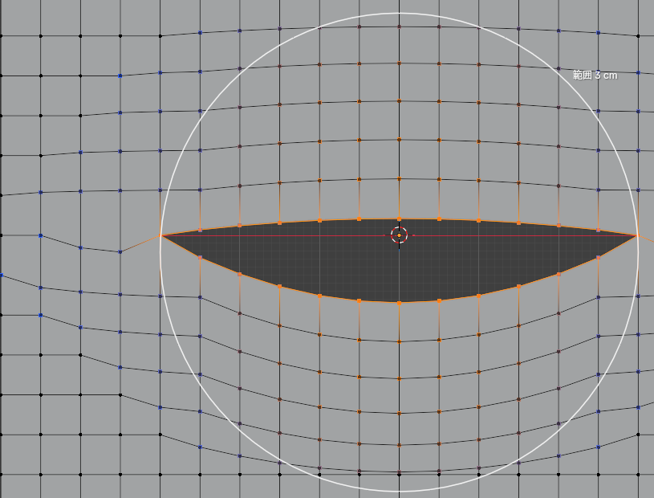

# 面に沿ってスライド（プロポーショナル）

Blender 5.x のアドオン（extension）。編集モードで、選んだ頂点を**顔の面から浮かせず・めり込ませずにすべらせ**、
まわりの頂点も**プロポーショナル編集の減衰**でついてくる。口を開ける・口角を上げるなどの表情シェイプキー作り向け。

*Blender 5.x extension: slide selected vertices along the mesh surface with proportional falloff — handy for facial shape keys (open mouth, raise mouth corners). UI and manual are in Japanese.*



- 使い方：[docs/manual.html](docs/manual.html)（Blender の N パネル「面スライド」→「使い方を開く」でも開く）
- 仕組み・テスト・実測：[docs/DEVELOPER.md](docs/DEVELOPER.md)

## いちばん短い使い方

1. 編集モードで、書き込みたいシェイプキーを選び、動かしたい頂点を選ぶ
2. マウスを 3D ビューに置いて **Shift+Alt+V**（右クリックメニュー・「頂点」メニュー・N パネルからも）
3. 動かして左クリックで確定。ホイールで範囲、`A` で口を開く、`M` で左右対称、`F` で面に沿わせる ON/OFF

## 入っているもの

| ファイル | 中身 |
|---|---|
| `__init__.py` | オペレーター（モーダル）・N パネル・メニュー・ステータスバーと 3D ビューの描画・キーマップ |
| `core.py` | 計算だけ（重み・面に沿った移動・口を開く・左右対称）。bpy の UI に触らない |
| `ui_text.py` | 画面に出す文言（ヘッダー・ステータスバー・メッセージ・マニュアルのキー表） |
| `blender_manifest.toml` | extension の情報（id `proportional_surface_slide`・版 2.0.0・Blender 5.0 以上） |
| `docs/` | マニュアル（`manual.html`・`img/`）と開発メモ（`DEVELOPER.md` は zip に入れない） |
| `tests/` | テスト（zip に入れない） |

## 入れ方

配布用の zip を作る（`tests/`・`docs/DEVELOPER.md` は除かれる）：

```
blender --command extension build --source-dir <このフォルダ> --output-dir <出力フォルダ>
```

できた `proportional_surface_slide-2.0.0.zip` を Blender の画面にドラッグ＆ドロップするか、
プリファレンス → Get Extensions → 右上の ∨ → Install from Disk… で入れる。更新したら Blender を開き直す。

## ライセンス

GPL-3.0-or-later（Blender のアドオンなので Blender と同じ）。全文は `LICENSE`。
