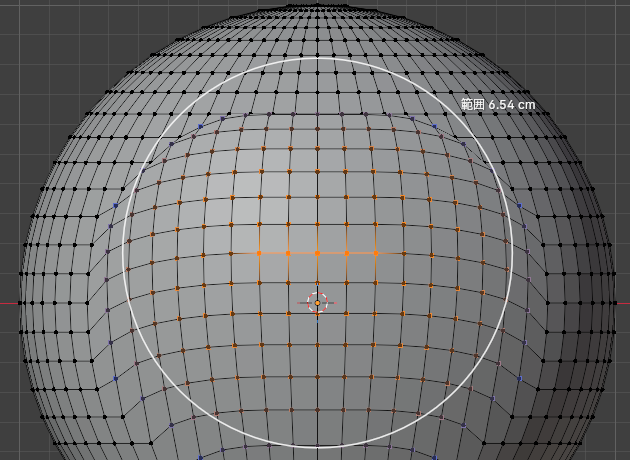
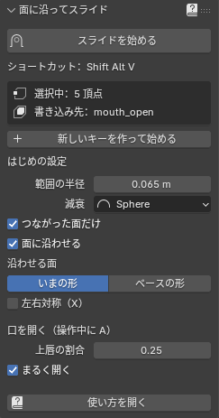

# 面に沿ってスライド（プロポーショナル）

Blender 5.x のアドオン（extension）です。編集モードで選んだ頂点を、**顔の面から浮かせず・めり込ませずにすべらせ**、
まわりの頂点も**プロポーショナル編集と同じ減衰でいっしょにすべらせます**。
口を開ける・口角を上げる・眉を傾けるといった、表情シェイプキーを作るための道具です。

*Blender 5.x extension: slide selected vertices along the mesh surface while neighbours follow with proportional falloff — like Vertex Slide + Proportional Editing combined. Made for facial shape keys (open mouth, raise mouth corners, tilt eyebrows). Move / scale / rotate along the surface, a dedicated "open mouth" mode, and X-mirror. UI and manual are in Japanese.*


## どんなときに使うの？

表情のシェイプキーを作るとき、ふつうはこのどちらかで頂点を動かします。

| 道具 | 困るところ |
|---|---|
| G（移動）＋プロポーショナル編集 | まっすぐ動くので、丸い顔の上では頂点が**面から浮いたり、中へめり込んだり**する。あとでスムーズやスカルプトで直すことになる |
| 頂点スライド（G G） | 面の上には残るけれど、**選んだ頂点しか動かず**、辺の上しか動けない。まわりがついてこないので段差になる |

このアドオンは、その 2 つをいっしょにしたものです。

- 選んだ頂点は、**面の上をなめらかにすべって**移動します（辺の上に限らず、どの向きにも）
- まわりの頂点は、**プロポーショナル編集と同じ範囲・減衰で**、少しずつ同じようにすべってついてきます
- 結果は、いま選んでいる**シェイプキーに書き込まれ**ます（Basis は守ります）



## できること

- **移動（G）・拡大縮小（S）**：ふつうの G・S と同じ感覚で、面に沿って動かす・広げる
- **回転（R）**：選んだ所の真ん中を中心に、面に沿って回す。軸ははじめ「面の向き」なので、斜めから見ていても顔の上でその場で回る（もう一度 R で画面の奥向き、X/Y/Z で軸も決められる）。大きく回しても中心へ縮まない。**左右対称と組み合わせると反対側は逆向きに回る**ので、困り眉・怒り眉・つり目・たれ目が一度で作れる
- **口を開く（A）**：唇の切れ目のまわりを選んで A を押すと、上唇・下唇・口角に自動で分けて、下唇はマウスについて下へ、上唇は少しだけ上へ、口角は止めたまま、まるく口を開けます。閉じた口から「あ」を作るためのモード
- **左右対称（M）**：反対側も鏡に写したように動く（メッシュの X ミラーの設定で始まる）
- **つながった面だけ（Alt+O）**：メッシュをたどった距離で範囲を決めるので、上唇を動かしても、すぐ下の下唇はついてこない
- **口の中や裏側に吸い付かない**：画面を向いている面・選んだ頂点とつながっている面・隠していない面だけに沿わせる。歯やまつげは H で隠せば無視される
- **ベースの形に沿わせる（B）**：同じキーを何度も直して形がゆがんできたとき、Basis の面を基準にすべらせる
- **面に沿わせる OFF（F）**：「う」の突き出しのように、面から離したいときはふつうのプロポーショナル移動に切り替え
- **数値入力・F9**：`Z 0.005 Enter` のように量を打てる。確定後も F9 のパネルで量・範囲・減衰などを直すと、動かす前からやり直して反映
- **事故を防ぐ**：書き込み先が Basis（ほかに表情キーがあるとき）やロック中のキーなら止めて理由を出す。範囲の半径がモデルに比べて大きすぎ・小さすぎなら直して始める
- **いまの状態が見える**：ヘッダーに量・範囲・書き込み先・動く頂点の数・⚠、ステータスバーに押せるキーと ON/OFF、3D ビューに範囲の円と、ついてくる量を色分けした点
- **新しいキーを作って始める**：キーの追加から動かし始めるまでボタン 1 つ（やめたら作ったキーは消える）

## 使い方（いちばん短く）

1. 編集モードで、書き込みたいシェイプキーを選び、動かしたい頂点を選ぶ
2. マウスを 3D ビューに置いて **Shift+Alt+V**（右クリックメニュー・「頂点」メニュー・N パネルの「面スライド」タブからも。メニューからのときは、十字カーソルで始めたい所をクリック）
3. マウスで動かして、左クリックで確定（右クリック・Esc でやめる）

操作中のおもなキー：

| キー | すること |
|---|---|
| ホイール下 / 上 | 範囲を広く / 狭く |
| G / S / R / **A** | 移動 / 拡大縮小 / 回転（もう一度 R で軸を 面の向き ⇄ 画面の奥） / **口を開く** |
| X・Y・Z（Shift で平面） | 軸で絞る・回転ではその軸のまわり（押すたびに グローバル → ローカル → 解除） |
| Shift+O / Alt+O | 減衰の曲線 / つながった面だけ |
| **F / B / M** | **面に沿わせる / 沿わせる面（いまの形・ベース） / 左右対称** |
| 数字 | 数値入力（回転は度） |

太字がこのアドオンだけのキーで、ほかは Blender の G と同じです。くわしい説明・表情ごとのレシピ・うまくいかないときの表は、
マニュアル [docs/manual.html](docs/manual.html) にあります（zip に入っていて、N パネルの「使い方を開く」でブラウザに出ます）。



## できないこと

- 動くのはアクティブなオブジェクトだけです
- 左右対称は「位置」で相手を探します（Basis で左右がぴったり同じ位置の頂点どうし。トポロジーミラーではありません）
- シェイプキーの値を途中（0.5 など）にすると、曲がった面の上を大きく動かした頂点は、途中で少し面の内側を通ります（シェイプキーは直線でつなぐため）

## 入れ方

1. [Releases](https://github.com/hypertuyotuyo/proportional-surface-slide/releases) から `proportional_surface_slide-2.1.0.zip` をダウンロード
2. Blender の画面にドラッグ＆ドロップ（または プリファレンス → Get Extensions → 右上の ∨ → Install from Disk…）
3. 更新したときは Blender を開き直す

Blender 5.0 以上（5.2 で確かめています）。

## 開発者向け

| ファイル | 中身 |
|---|---|
| `__init__.py` | オペレーター（モーダル）・N パネル・メニュー・ステータスバーと 3D ビューの描画・キーマップ |
| `core.py` | 計算だけ（重み・面に沿った移動と回転・口を開く・左右対称）。bpy の UI に触らない |
| `ui_text.py` | 画面に出す文言（ヘッダー・ステータスバー・メッセージ・マニュアルのキー表） |
| `blender_manifest.toml` | extension の情報（id `proportional_surface_slide`・版 2.1.0・Blender 5.0 以上） |
| `docs/` | マニュアル（`manual.html`・`img/`）と開発メモ（`DEVELOPER.md` は zip に入れない） |
| `tests/` | テスト（zip に入れない） |

仕組み・テストの回し方・実測は [docs/DEVELOPER.md](docs/DEVELOPER.md)。zip は次のコマンドで作ります（`tests/`・`docs/DEVELOPER.md` は除かれる）。

```
blender --command extension build --source-dir <このフォルダ> --output-dir <出力フォルダ>
```

## ライセンス

GPL-3.0-or-later（Blender のアドオンなので Blender と同じ）。全文は `LICENSE`。
